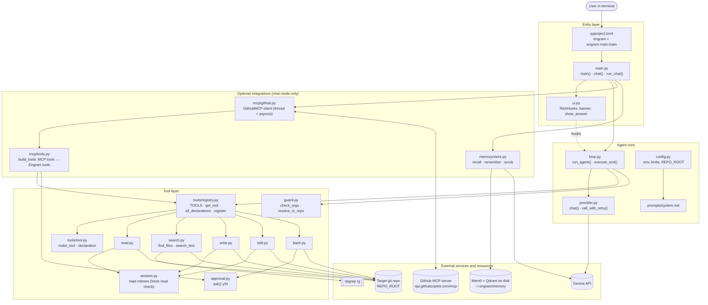
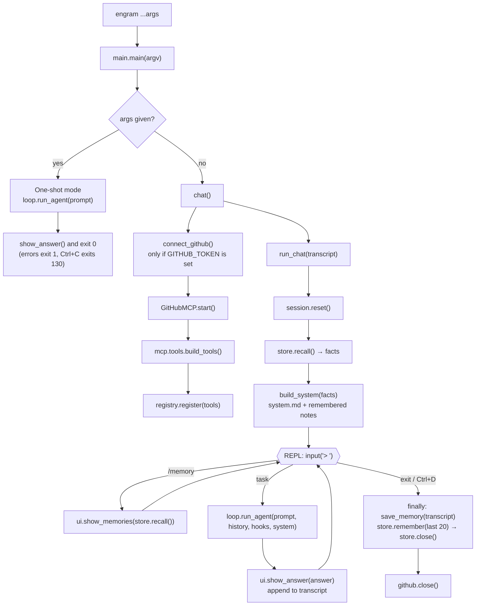
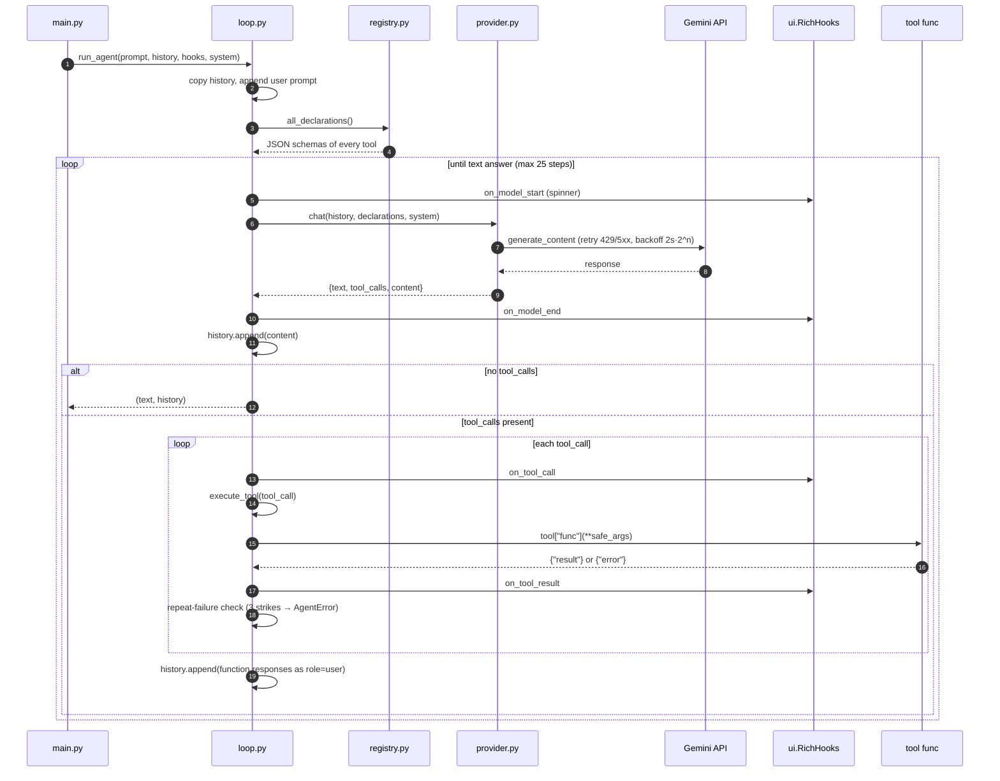
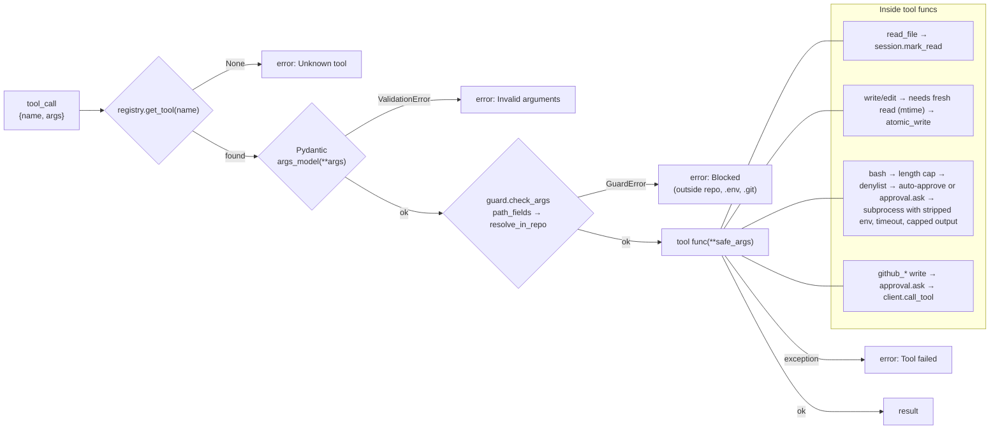
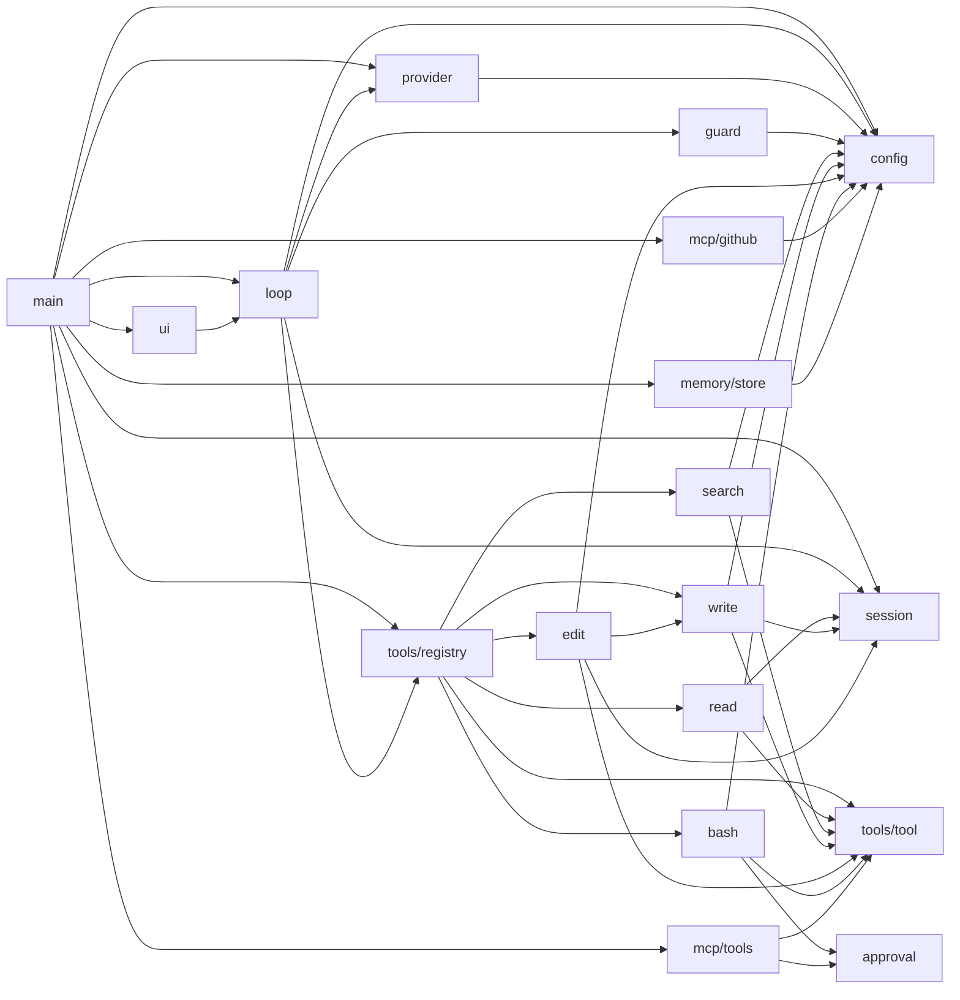

# Engram: System Design

The diagrams below use Mermaid, so they render on GitHub, in VS Code (with a Mermaid
extension) and in `system_design.html`, which opens in any browser.

---

## 1. High-level architecture

**Layers in one line each**

| Layer | Files | Job |
|---|---|---|
| Entry | `main.py`, `ui.py` | Parse args, pick one-shot or chat mode, show output |
| Agent core | `loop.py`, `provider.py`, `config.py` | Think, act, observe cycle; talk to Gemini with retries |
| Tools | `tools/*`, `guard.py`, `session.py`, `approval.py` | Validated, path-guarded actions on the repo |
| Integrations | `mcp/*`, `memory/store.py` | GitHub tools and per-repo memory (chat mode only) |

---

## 2. Program lifecycle (what runs when you type `engram`)

---

## 3. One agent turn (`loop.run_agent`)

---

## 4. Tool execution pipeline (`loop.execute_tool`)

Every tool call, local or GitHub, passes through the same four gates.

Errors are returned to the model as data, not raised, so the model can correct itself.
Only `AgentError` (step limit, repeated failure) and `ProviderError` stop a turn.

---

## 5. Module dependency graph (who imports whom)

`config.py` is the leaf everything depends on. `context.py` and `provider_open_router.py`
are empty placeholders for planned work (history trimming, OpenRouter provider).

---

## 6. Data that moves through the system

| Data | Shape | Created in | Consumed by |
|---|---|---|---|
| `history` | list of `google.genai.types.Content` | `loop.run_agent` | `provider.chat` (sent to Gemini) |
| tool declaration | `{name, description, parameters}` | `tools/tool.declaration` | Gemini, via `provider.chat` |
| tool dict | `{name, description, args_model, func, path_fields, schema?}` | `make_tool` | `registry`, `execute_tool` |
| `tool_call` | `{name, args}` | `provider.chat` | `loop.execute_tool` |
| tool output | `{"result": ...}` or `{"error": ...}` | `execute_tool` | back to Gemini as a function response |
| `transcript` | `[{role, content}]` (plain text) | `main.run_chat` | `store.remember` at exit |
| facts | `list[str]` | `store.recall` | `main.build_system` → system prompt |
